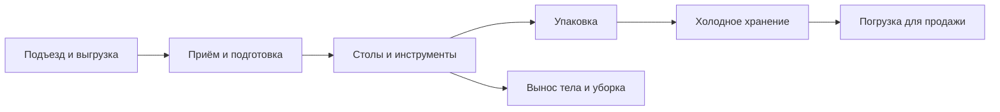

# VOLUNTEERS ONLY — мир, лаборатория и Тихая долина

Дата: 28.10.2026. Версия: v01. Дизайн/границы содержания, не изменение карты.

## 1. Окончательная отмена острова-казино

Confirmed, последняя поправка Феди: **острова-казино в игре не будет**. Это отмена содержания, не перенос на время после первой версии. Все прежние фразы «Confirmed дополнительный Casino Island», «поздний остров», будущие мини-игры/награды/поездки на него — superseded для планирования.

Отмена относится только к Casino Island. Военный/президентский остров Трамдуро, его резиденция, связь с мини-портом и согласованный мост сохраняются. Клуб в Тихой долине — отдельное существующее направление замены старого местного казино; он не возвращает отдельный остров/азартную экономику. Эта задача не удаляет старые сцены, ассеты, геометрию, острова или ссылки в других файлах. Будущая синхронизация карты/канона — отдельная явно ограниченная работа.

Confirmed — ответы и согласованные источники. Proposed — проект автора по оставшейся делегации. Наличие схемы/модели не считается готовым интерьером. Утверждение нового производства следует порядку референсов/текстур проекта.

## 2. Источники и неизменяемые границы

Основа: [канон](../VOLUNTEERS_ONLY_GAME_SPEC_AND_LORE_CURRENT_CANON.md), [PRODUCT](../PRODUCT.md), [MAP handoff v10](MAP_BUILD_HANDOFF_FEDYA_2026-10-20_v10.md), [ответы 22.10](../reports/W86_2026-10-22/ANSWERS_FEDYA_2026-10-22.md), [POLICE](POLICE_SUSPICION_SPEC_2026-10-18_v01.md), [NPC v07](NPC_BEHAVIOUR_SPEC_2026-10-21_v07.md), [экономика](ECONOMY_SALES_PROGRESSION_SPEC_2026-10-25_v01.md), [миссии](STORY_MISSIONS_SPEC_2026-10-28_v01.md).

Пять основных баз: вагон → Хутор → Rough → Downtown → лаборатория Quiet Valley. На Стройке базы нет. Пляж/порт/Elite/военный остров не становятся новыми обязательными базами. Мир физически открыт, основная прогрессия идёт через контакты/имущество/заказы. Новая схема не меняет уже согласованные проходы, дороги, высоты, ловушки или границы. Пакет рельефа для Вадима здесь не возобновляется.

Последние NPC/POLICE сильнее старого OPEN о населении долины: **обычных гражданских в Quiet Valley нет**. Нельзя ради красивой темы создать там толпу посетителей клуба, VIP-ферму или безопасный бесконечный источник пациентов. Лаборатория не даёт иммунитет от реальной входящей погони/оснований реакции. Покрытие/маршруты полиции остаются у Вадима.

## 3. Proposed: характер Тихой долины

Спокойная прибрежная зона природы и редких крупных объектов: лаборатория, существующее клубное здание, водопад/пруд/берег и подъезды. Внешне тихая, просторнее города, с локальными светом/звуком клуба; без новой системы гражданской жизни. Это визуально-функциональная конкретизация, не новая обязательная база/миссия или смена назначений районов.

Днём читаются рельеф, дорога и входы; ночью — адресные функциональные огни лаборатории, локальный клубный свет и существующий природный фон. Клубная музыка слышна рядом, а не всей карте. Пустое место не заполняется посторонними зданиями/дорогими NPC только ради «насыщенности». Работники, реально нанятые командой, и конкретные сюжетные/ответные персонажи принадлежат своим контрактам, не обычному районному спавну.

Клуб Proposed служит атмосферным ориентиром/посещаемым пространством при наличии утверждённого интерьера; не нужен для открытия лаборатории, мафиози, VIP или финала. До готового интерьера наружный вид/локальный звук достаточны; закрытая дверь не должна обещать уже работающие мини-игры. Название/вывеска/референс выбираются в художественном процессе, а не считаются выбранными этим текстом.

## 4. Лаборатория: самая проработанная база

Confirmed: купленная лаборатория стоит $135 000, доступна в каталоге после знакомства с первым скупщиком, покупается пустой. Она условие VIP, но её покупка не открывает автоматически недостающих покупателей/органы. Старая недвижимость/оснащение сохраняются. Электричество $500/игровые сутки, отдельно от других баз.

Proposed функциональная схема потоков, не готовая геометрическая планировка:

| Зона | Функциональное требование |
|---|---|
| Подъезд/выгрузка | Валидная остановка бусика, доступ к грузовой двери, переноска NPC/двуручного холодильника без обязательного прыжка. |
| Приём | Свободное физическое место под доставленных NPC; не новая магическая очередь, не бесплатные крепления. |
| Операционная | Несколько расставляемых столов с реальной досягаемостью/проходами; нет фиксированного лимита «4 на всю игру». |
| Упаковка | Отдельные рабочие поверхности/место необязательного упаковщика; пакет не заменяет холодильник. |
| Хранение | Купленные холодильники/контейнеры с конечными слотами; оплаченный срок питания виден в телефоне. |
| Персонал | Проходы к назначенным столам, ожидание/перенос без блокировки основных дверей. |
| Вынос/уборка | Достижимый обычный путь тела/пакетов, пятен/инструментов уборки; не автоматическая наружная утилизация. |

Все зоны — пригодное пространство, не бесплатно появляющееся оборудование. Лаборатория должна быть наиболее подробно оформленной и удобной по существующим действиям, а не иметь собственные реалистичные медицинские системы или бесплатное улучшение качества. Больше места/параллельности/организации — понятная польза; низкие базы не становятся бесполезными.

Двери/коридоры проверяются реальным бусиком/телом/контейнерами и двумя встречными игроками. Численные размеры нельзя выдумать как факт без реального layout. Макет будущего интерьера сначала согласуется референсом/текстурами; этот документ не даёт разрешение передвинуть существующую базу или снести стены общей карты.

## 5. Природа, время и погода

Сохраняются утверждённые водопады/река/берег и существующая связь дорог, без повторной разработки всей долины. Дорожные стыки проезжаемы, фоновые горы не стоят на проезде, вода/берег без незапланированных ступеней. Растительность не выталкивает игрока/бусик с обязательного маршрута. Проверка сверху не заменяет вид с земли/проезд.

Сутки — унаследованные 45 активных реальных минут; 06:00/18:00 дают общие дневные/ночные занятия, отдельные миссии сохраняют свои окна. Закрытый мир не стареет. Не вводить сон/перемотку, бесплатно обновляющую тайники/находки и не оплачивающую сроки; такая механика не была выбрана.

Proposed первый погодный набор — существующие облачность, ветер и смена освещения в согласованном стиле. Новые ливень/гроза/снег и изменение сцепления/скорости порчи погодой не входят в первый контракт. Это сдержанный выбор объёма, не обещание динамического климата. Добавление дождя позже требует ресурсов/замеров и не может тайно ослабить согласованный фургон.

Переход из тёмного места/тоннеля даёт мягкую адаптацию света, Proposed около 0,5–1,5 с, без продолжительной полной белизны, скрывающей дорогу. Настройки качества не удаляют физические объекты/последствия. Водитель продолжает видеть безопасный проезд.

## 6. Мир после финала и связи с другими блоками

По Q2 после истории Трамдуро продолжается тот же мир. Финальный событийный контракт должен оставить возможность обычной игры без сброса имущества и без повторной уникальной награды. Этот документ не сочиняет финальную атаку/охрану/государственную реакцию. Сохранённая память/погоня обрабатываются их владельцем; новая обычная толпа не очищает последствия.

Связи: [прогрессия](CORE_LOOP_PROGRESSION_SPEC_2026-10-28_v01.md) не закрывает помещения по уровню; [операции](OPERATIONS_BASES_INTEGRATION_SPEC_2026-10-28_v01.md) определяют работу столов/порчу; [NPC](NPC_SCHEDULES_INTEGRATION_SPEC_2026-10-28_v01.md) не создаёт обычных гражданских в долине; [вид/звук](LOOK_AUDIO_UI_SPEC_2026-10-28_v01.md) задаёт стиль/локальную музыку; [сохранения](SAVE_PROGRESS_SPEC_2026-10-28_v01.md) сохраняют купленное и последствия.

## 7. Приёмка

| ID | Критерий |
|---|---|
| WL-01 | Casino Island отсутствует в новом составе игры/заказов/цен/будущей дорожной карте; это отмена, не перенос. |
| WL-02 | Остров Трамдуро, мини-порт и согласованный мост не отменяются вместе с казино. |
| WL-03 | Клуб долины не возвращает остров, азартную валюту/игры или обязательную сюжетную ступень. |
| WL-04 | В долине нет обычного гражданского генератора; наёмные/сюжетные NPC идут по своим контрактам. |
| WL-05 | Лаборатория покупается пустой за $135 000, VIP/контакты проверяют свои независимые условия. |
| WL-06 | Все заявленные зоны физически пригодны; число столов ограничено местом/производительностью, не выдуманным четырёхстольным лимитом. |
| WL-07 | Погрузка/переноска/двери/пути персонала проходят реальную проверку с объектами, а не только схему. |
| WL-08 | Покупка помещения не выдаёт бесплатные холодильники, процедуры, качество или охранный иммунитет. |
| WL-09 | Оплата лаборатории отдельно от остальных; выключенный холодильник сохраняет вещи, но не холод. |
| WL-10 | Погода/тоннельный свет не вводят скрытую физическую сложность и не закрывают водителю дорогу. |
| WL-11 | Нет автоматической перемотки суток/офлайн-прогресса и ежедневного повторного уникального финала. |
| WL-12 | Карта/ассеты не удалены по одному изменению дизайна; будущая работа ограничена подтверждённым местом/референсом. |

## 8. Статус и продолжение

Открытого интервью по этому проходу нет. Требуются реальные референсы/план лаборатории, геометрия/размещение устройств, авторские ресурсы клуба и подтверждённая внешняя реакция финала. Вопросы не заменяются выдуманными готовыми сценами. Существующие документы сохраняются как история; новый факт отмены острова должен учитываться будущими исполнителями вместе с этим файлом. Код/ассеты/сцены/WORK_SYNC не менялись. Рендер, проезд, коллизии, производительность и человеческое принятие интерьера NOT RUN; текущая проверка документальная.

Документальная проверка 28.10.2026 — PASS: 8 последовательных разделов, 2 таблиц, 12 уникальных последовательных критериев, 13 действующих локальных ссылок. Общая сверка шести новых документов: 81 критерий; арифметика XP/порогов и сумм весов NPC проверена, 36 ранее существовавших спецификаций сохранены побайтно. Это результат проверки текста, а не приёмки игры.
